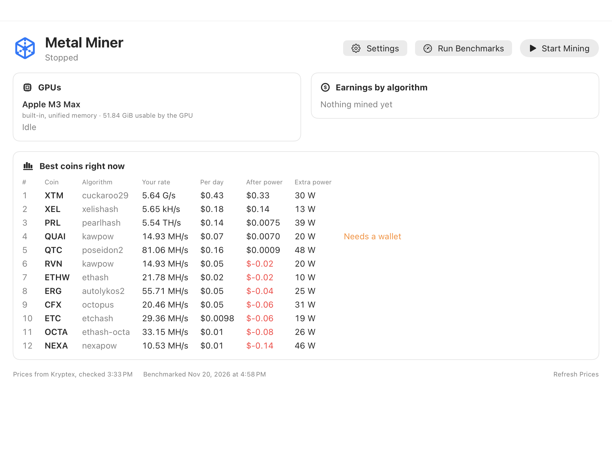

# Metal Miner

Mine cryptocurrency on your Mac's GPU. Metal Miner runs proof-of-work algorithms natively in Metal on
Apple silicon, measures what your Mac would earn with each coin on [Kryptex Pool](https://pool.kryptex.com),
and keeps mining whichever coin pays best, switching as prices move.

- **12 coins on the GPU**: Tari, Xelis, Quantus, Pearl, Ravencoin, Quai, Conflux, Ergo, Ethereum PoW, Nexa,
  OctaSpace and Ethereum Classic. Each algorithm is checked against its coin's official test vectors, and
  every coin but Quai has had shares accepted on Kryptex.
- **Always the best-paying coin**: coins are ranked by what your Mac would earn, with live Kryptex prices,
  re-checked every 10 minutes.
- **Paid your way**: into one Kryptex account, cashed out in BTC or USDT, or straight to your own wallet for
  each coin.
- **Electricity-aware**: it measures the GPU's power draw, ranks by earnings after power once you enter your
  price, and can mine only while that's positive.
- **Quiet mode**: mines more slowly so the fans stay at their lowest speed.

Requires an Apple silicon Mac (M1 or later) on macOS 15 or later.

## Install

Download the latest `Metal-Miner-<version>.zip` from [Releases](../../releases), unzip it, and move Metal
Miner to your Applications folder. Releases are signed with a Developer ID and notarized by Apple, so they
open like any other app.

Metal Miner isn't in the Mac App Store: Apple's rules don't allow apps that mine cryptocurrency on the device
(App Review Guideline 3.1.5(ii)).

## Getting started

1. Open Metal Miner and click **Run Benchmarks**. It measures your GPU on every coin, which takes about six
   minutes and warms the Mac up, then ranks the coins.
2. Click **Start Mining**. The first time, it asks where your earnings go:
   - **Kryptex account**: the email of your [kryptex.com](https://www.kryptex.com) account. Earnings from
     every coin collect there and pay out in BTC or USDT. Kryptex doesn't pay Quai into accounts yet, so
     Quai is skipped.
   - **My own wallets**: an address for each coin you want to mine. Coins without one are skipped.
3. Metal Miner mines the best coin it can. It shows the rate, the GPU's power and the fan speeds, and adds up
   your earnings by coin as the pool accepts shares. On Kryptex, your Mac shows up as the worker
   `metalminer`.

In **Settings** you can also enter your electricity price, mine only while earnings beat it, turn on quiet
mode, and rename the worker.

## What to expect

On an M3 Max the best coin earns roughly $0.45 a day before electricity (Tari, using about 30 W of GPU
power); smaller Macs earn less. Prices and network difficulty change daily, and the app re-ranks as they do.
Measured rates and earnings for every coin: [docs/RESULTS.md](docs/RESULTS.md).

Mining keeps the GPU busy, so the Mac runs warm and the fans spin up unless quiet mode is on (which earns
less). Kryptex takes a 1-3% pool fee.

| Coin | Algorithm | Rate on an M3 Max | Kryptex pays into |
|---|---|---|---|
| Tari (XTM) | Cuckaroo29 | 5.64 graphs/s | an account or a wallet |
| Xelis (XEL) | XelisHash v3 | 5.65 kH/s | an account or a wallet |
| Quantus (QTC) | Poseidon2 | 81.1 MH/s | an account or a wallet |
| Pearl (PRL) | PearlHash | 5.54 TH/s | an account or a wallet |
| Ravencoin (RVN) | KawPow | 14.9 MH/s | an account or a wallet |
| Quai (QUAI) | KawPow | 14.9 MH/s | a wallet only |
| Conflux (CFX) | Octopus | 20.5 MH/s | an account or a wallet |
| Ergo (ERG) | Autolykos2 | 55.7 MH/s | an account or a wallet |
| Ethereum PoW (ETHW) | Ethash | 21.8 MH/s | an account or a wallet |
| Nexa (NEXA) | NexaPow | 10.5 MH/s | an account or a wallet |
| OctaSpace (OCTA) | Ethash | 33.2 MH/s | an account or a wallet |
| Ethereum Classic (ETC) | Etchash | 29.4 MH/s | an account or a wallet |

## Build from source

You need Xcode, for its Swift toolchain and macOS SDK. There are no other dependencies: `build.sh` calls
the toolchain directly and keeps everything it writes in `.build/`.

    ./build.sh                          # the app and the command line, in .build/all/
    open ".build/all/Metal Miner.app"
    ./test.sh                           # unit tests: offline, no GPU
    ./test.sh --gpu                     # plus every algorithm and pool connection on the GPU (a few minutes)

Built from a checkout, the app and the command line keep settings, benchmarks and earnings in the checkout
(`settings.json` and `results/`, both git-ignored); an installed copy uses
`~/Library/Application Support/Metal Miner`.

## Command line

`metalminer` does what the app does, plus testing and diagnostics. Run it with no arguments for every
command and option.

    .build/all/metalminer info                        # GPUs, memory limits, GPU power now
    .build/all/metalminer bench all --seconds 30 --cooldown 30
    .build/all/metalminer rank                        # what each coin pays now, from the newest benchmark
    .build/all/metalminer settings --payout kryptex --kryptex-user you@example.com
    .build/all/metalminer settings --payout wallets --wallet RVN=ADDRESS --wallet ERG=ADDRESS
    .build/all/metalminer settings --kwh 0.12 --profit-only yes --quiet yes
    .build/all/metalminer mine xtm-c29 --seconds 600  # one pool with your payout (--trace shows its traffic)
    .build/all/metalminer test all                    # official vectors and GPU/CPU cross-checks
    .build/all/metalminer pooltest                    # every pool connection against a local test pool

## How it works

Each algorithm is a folder under `Sources/Algorithms/`: a CPU reference implementation checked against the
coin's published vectors, Metal kernels in `Kernels/` cross-checked against that reference, and a Stratum
connection to its Kryptex pool. The engine benchmarks the algorithms, values each rate with Kryptex's public
API (Kryptex's own estimate for PPS+ pools, otherwise this Mac's share of the coin's daily emission after
the fee), and mines the best coin. The SwiftUI app and the command line are thin front-ends over the engine.

- [docs/ARCHITECTURE.md](docs/ARCHITECTURE.md): how the pieces fit
- [docs/PORTING.md](docs/PORTING.md): adding an algorithm or a pool connection
- [docs/RELEASING.md](docs/RELEASING.md): signing, notarizing and publishing a release
- [docs/specs/](docs/specs/): one note per algorithm, with its sources and live results

Earnings shown are estimates from live pool data; what you're paid is up to the pool. Metal Miner isn't
affiliated with Kryptex or any of the coins' projects.

## License

GPL-3.0 (see [LICENSE](LICENSE)): anyone may use, study, change and share Metal Miner, and anyone who shares
a changed version has to share its source under the same license.
